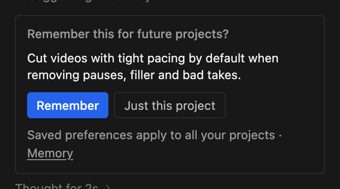

Daydream's AI can remember how you like to edit and apply it to every project. Say "always" or "from now on" ("always use one-word captions"), approve the card that appears, and the AI follows that preference in every video after.

You'll find everything it remembers in the **Memory** panel, under **Preferences**.

## Save a preference

Talk to the AI the way you'd brief an editor:

<Prompt description={"From now on, always cut with tight pacing."} actions={["copy"]}>
From now on, always cut with tight pacing.
</Prompt>

<Prompt description={"Remember that I like captions one word at a time, in yellow."} actions={["copy"]}>
Remember that I like captions one word at a time, in yellow.
</Prompt>

<Prompt description={"Every video should end with my logo animation."} actions={["copy"]}>
Every video should end with my logo animation.
</Prompt>

The AI shows a card asking **Remember this for future projects?** Click **Remember** to save it for every project, or **Just this project** to use it here without saving it.

<Frame caption="The card the AI shows when you ask it to remember something.">
  
</Frame>

The AI only suggests saving something when you've said it should apply going forward. A one-off request like "make these captions yellow" changes this video and nothing else.

## How preferences are used

The AI reads your preferences at the start of every chat and follows them without being asked. When it applies one, it says so briefly ("used your tight pacing").

If you ask for something different in a particular video, your request wins for that video.

## Edit or delete preferences

Open **Memory** and go to **Preferences**. You can:

- add one yourself with **Add instruction**
- edit any preference
- delete ones you don't want anymore

To replace a preference, you can also just tell the AI ("actually, I want captions in white now"). It suggests updating the old one rather than adding a second.

## Limits

- You can save up to 30 preferences, each up to 200 characters.
- Preferences are stored on your computer. They apply to every project on that computer.
- A preference is a sentence the AI follows, not a saved style. To reuse an exact caption style or graphic, [save it](/automate/saved-styles), then save a preference that names it ("always use my Bold Yellow captions").

## Related pages

- [Save caption styles and graphics](/automate/saved-styles)
- [Create recipes](/automate/recipes)
- [How to work with the AI](/ai/work-with-the-ai)
