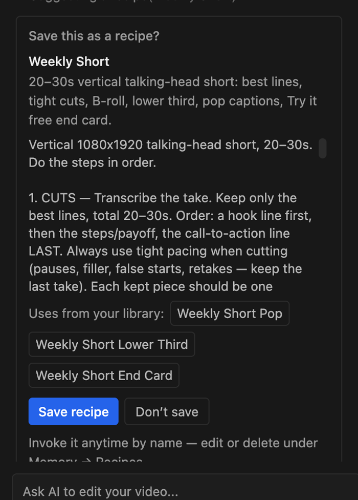

A recipe is an editing routine you save once and run by name on future videos. If you make the same kind of video every week, save the steps as a recipe ("cut tight, add B-roll every sentence, Bold Yellow captions, my outro") and next time just say "make this a Weekly Short".

## Save a recipe

The easiest way is after you've finished an edit you like:

> Save what we just did as a recipe called Weekly Short.

The AI writes up the steps from your conversation and the finished timeline, and shows a card asking **Save this as a recipe?** with the instructions and any saved caption styles or graphics it uses. Read it over, then click **Save recipe**. If something's missing, tell the AI before saving ("also add a zoom on every hook").

<Frame caption="The recipe card, listing the saved styles the recipe uses.">
  
</Frame>

If you only want to capture the look and not the steps, or the other way round, say so. The AI asks when it can't tell.

You can also write one yourself: open **Memory**, go to **Recipes**, click **New recipe**, fill it in, and click **Add recipe**.

## Run a recipe

In a new project, import and transcribe your footage, then ask:

> Make this a Weekly Short.

> Run my podcast clip recipe on this video.

The AI reads the recipe, tells you briefly what it's applying, and works through it. It uses the saved caption styles and graphics the recipe names, exactly as saved.

If a recipe conflicts with one of your [preferences](/automate/preferences), the recipe wins while it's running.

## Write recipes that work well

- Save your caption styles and graphics first, then mention them by name. A recipe that says "use my Bold Yellow captions" gets the exact style. One that says "yellow captions" gets the AI's best guess.
- Say how strict to be. "Always end on the logo animation" and "add B-roll where it helps" read differently to the AI, which is what you want.
- Keep one recipe per format. A recipe for shorts and another for long YouTube videos work better than one that tries to cover both.

## Update or delete a recipe

Ask the AI to change one ("update Weekly Short to use relaxed pacing") and approve the card, or edit it in **Memory** under **Recipes**.

## Limits

| Plan | Recipes |
|---|---|
| Free | Not included |
| Creator | 1 |
| Pro | No plan limit (Daydream holds up to 20) |

Recipe names can be up to 60 characters, and the instructions up to 2,400 characters. See [plans and limits](/help/plans-and-limits).

## Related pages

- [Remember your preferences](/automate/preferences)
- [Save caption styles and graphics](/automate/saved-styles)
- [Connect other AI tools](/ai/connect-other-ai-tools), to run recipes on several projects at once
