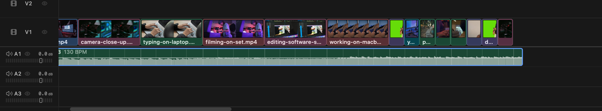

To edit a video to the beat in Daydream, put a song on the timeline and ask the AI to cut your clips to it. Daydream finds the song's beats, the start of each bar, and the moments it gets louder, like a drop or a chorus, so the AI can land every cut on the music.

## Cut a montage to the beat

1. Import your clips and your song. Put the song on an audio track.
2. Ask:

> Cut these clips to the beat, one shot per beat.

> Make a montage from my Japan clips, a new shot every bar, and save the best shot for the drop.

> Cut to the beat for the first 15 seconds, then slow down to one shot every two bars.

The AI lays the clips edge to edge, each starting and ending on a beat, and starts the first shot at the very beginning so the video doesn't open on black.

<Frame caption="A montage cut to a 130 BPM track: one shot per bar, then one per beat after the drop.">
  <video controls playsInline preload="metadata" className="w-full rounded-xl" style={{ maxWidth: '320px', margin: '0 auto' }} src="/images/guide/beat-montage.mp4" aria-label="A montage cut to a 130 BPM track: one shot per bar, then one per beat after the drop."></video>
</Frame>

If you move, trim or change the speed of the song afterwards, ask the AI to re-cut. The beats move with the song, but clips you already placed don't.

## See the beats on the timeline

Select the song and open **Properties**. The **Beats** section shows the tempo, and **On timeline** lets you show **Beats** or **Downbeats** (the first beat of each bar) as lines on the clip, so you can cut to them by hand. **Off** hides the lines, but the AI and beat effects still use the beats.

To see a song's beats, click **Detect beats** in the same section. It takes a few seconds. For a video's own sound, like a dance video with music in it, select its audio clip and click **Detect beats**. You don't need to do this for the AI or beat effects, which find the beats on their own when they need them.

<Frame caption="Beat lines on the song, with each cut landing on one.">
  
</Frame>

## Make effects and graphics move with the music

Cuts aren't the only thing that can follow the song:

> Make the title pop on every beat.

> Add a quick zoom punch on each beat in the chorus.

> Flash the screen white on the drop.

Effects that pulse or shake with the music are custom effects the AI writes for your project, and animated graphics can be timed to the beats too. See [custom effects and transitions](/style/custom-effects-and-transitions) and [add motion graphics](/style/motion-graphics).

These follow whichever song is playing on an audio track at that moment. Exports include them. When you send your edit to another editor, effects on a clip are rendered into a clip on their own track, but effects applied over the whole frame aren't carried over.

## Limits

- Speech, ambient sound and songs without a steady tempo show **No steady beat**. There's nothing to cut to, so the AI won't invent cuts.
- Beat detection works on songs up to 30 minutes long.
- Daydream doesn't include a music library. Use songs you have the rights to.

## Related pages

- [Mix your sound](/edit/mix-sound)
- [Add B-roll](/edit/add-b-roll)
- [Make your own effects and transitions](/style/custom-effects-and-transitions)
