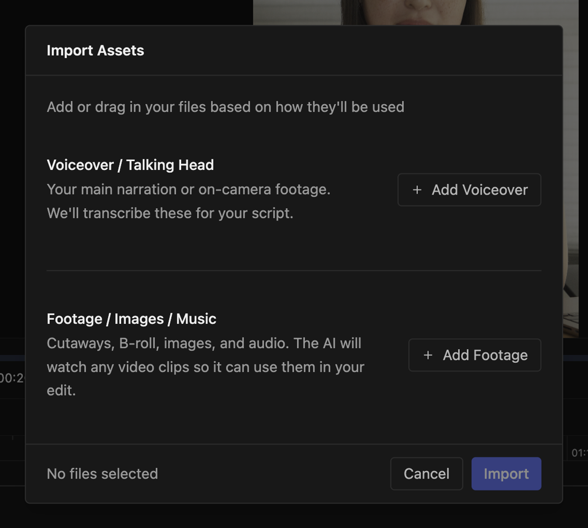

This walkthrough takes you from raw footage to an exported video in about 10 minutes. You'll use the steps you'll repeat on almost every edit: import, transcribe, cut, add B-roll, caption and export.

You'll need Daydream [installed](/install) with [Claude or ChatGPT connected](/connect-claude-chatgpt), a clip of you talking, and a few clips of B-roll.

<Steps>
  <Step title="Create a project">
    On the start screen, click **New Project**, give it a name, and create it.

    Every new project starts horizontal (16:9). If you're making a Reel, Short or TikTok, switch now with **File > Switch to Vertical Video (9:16)**. Switching before you edit means captions and graphics are built for the right shape from the start. More on this in [make a vertical video](/vertical-video).
  </Step>
  <Step title="Import your footage">
    In the **Assets** panel, click **Import**, or drag your files onto it.

    - Put the clip of you talking under **Voiceover / Talking Head**. Daydream transcribes these.
    - Put your B-roll under **Footage / Images / Music**. The AI watches these clips in the background so it can find shots for you later.

    Click **Import**.

    <Frame caption="The import window. The top box gets transcribed, the bottom box gets watched for B-roll.">
      
    </Frame>
  </Step>
  <Step title="Transcribe your talking-head clip">
    Open the **Transcript** panel and click **Transcribe Video** (or **Transcribe Voiceover** if it's an audio file). Pick your clip.

    <Frame caption="Clicking Transcribe Video, picking the clip, and the transcript appearing.">
      <video autoPlay muted loop playsInline className="w-full rounded-xl" src="/images/guide/ui-transcribe.mp4" aria-label="Clicking Transcribe Video, picking the clip, and the transcript appearing."></video>
    </Frame>

    When it's done, the transcript appears in the panel and the clip lands on the timeline. Short clips take a few seconds. An hour of footage can take a few minutes.
  </Step>
  <Step title="Cut the silences and bad takes">
    In the chat on the right, ask:

    > Cut the silences and any bad takes.

    Watch the timeline while the AI works. It reads the transcript, removes the pauses, keeps the last attempt of anything you said twice, and closes the gaps.

    When it's done, turn on **Show cuts** in the **Transcript** panel to see what it removed, struck through. Click a struck-through word and press **Delete** to bring it back, or press **Cmd+Z** (**Ctrl+Z** on Windows) to undo the whole cut.

    <Frame caption="Asking the AI to cut the silences and bad takes. The timeline shrinks from 1:38 to 26 seconds.">
      <video autoPlay muted loop playsInline className="w-full rounded-xl" src="/images/guide/ui-ai-cut.mp4" aria-label="Asking the AI to cut the silences and bad takes. The timeline shrinks from 1:38 to 26 seconds."></video>
    </Frame>
  </Step>
  <Step title="Add B-roll">
    Ask for B-roll the way you'd describe it to a person:

    > Add B-roll over the part where I talk about my morning routine.

    The AI picks shots from the footage you imported and places them on the track above your talking-head clip. If you want a different shot, say which one ("use the coffee shot instead").
  </Step>
  <Step title="Add captions">
    Click the captions button in the timeline toolbar (its tooltip says **Generate captions from transcript**), or ask the AI to "add captions". Captions appear on their own track, timed to your words.

    <Frame caption="One click on the captions button. The spoken word is highlighted as it plays.">
      <video autoPlay muted loop playsInline className="w-full rounded-xl" src="/images/guide/ui-captions.mp4" aria-label="One click on the captions button. The spoken word is highlighted as it plays."></video>
    </Frame>

    To change how they look, ask for a style ("one word at a time, the current word in yellow") or select a caption and edit its style in **Properties**. [Add captions](/style/captions) has more.
  </Step>
  <Step title="Export">
    Click **Export**, choose **Video**, and pick **TikTok/Reels** (or **YouTube** for a horizontal video). Click **Export to file**, choose where to save it, and wait for **Export complete**.
  </Step>
</Steps>

<Frame caption="The finished video: silences and bad takes cut, B-roll added, captions on.">
  <video controls playsInline preload="metadata" className="w-full rounded-xl" style={{ maxWidth: '320px', margin: '0 auto' }} src="/images/guide/result-first-video.mp4" aria-label="The finished video: silences and bad takes cut, B-roll added, captions on."></video>
</Frame>

That's a finished video. From here, most people tweak by asking for small changes ("tighten the pacing in the first 10 seconds", "zoom in when I say the price") and fixing the odd thing by hand.

## Related pages

- [How to work with the AI](/ai/work-with-the-ai)
- [Remove silences, pauses and filler words](/edit/remove-silences)
- [Add B-roll](/edit/add-b-roll)
- [Export a video](/finish/export)
