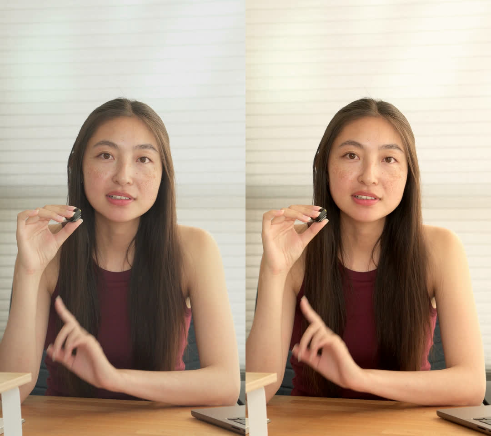
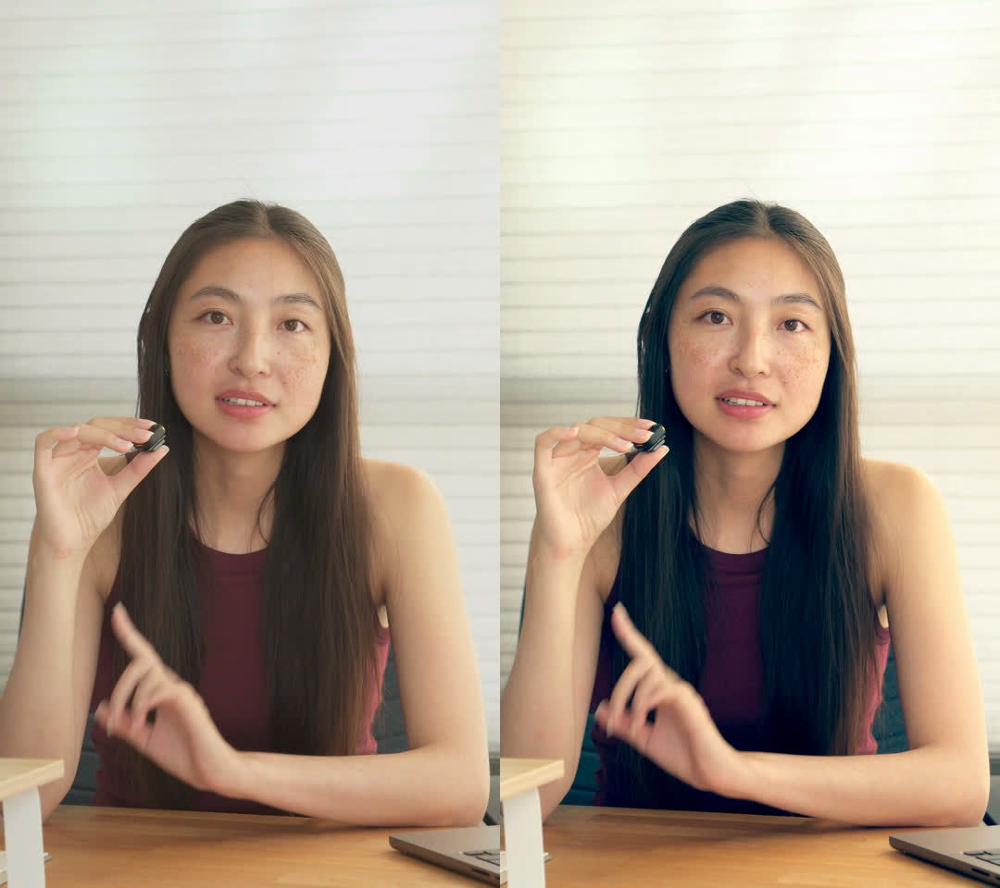
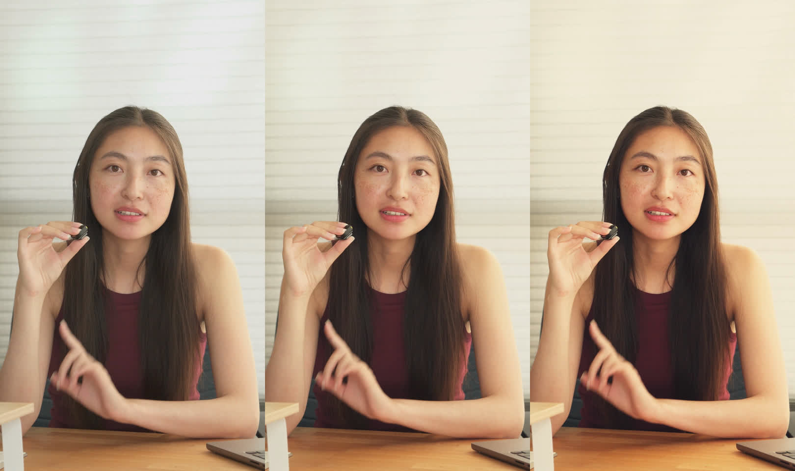
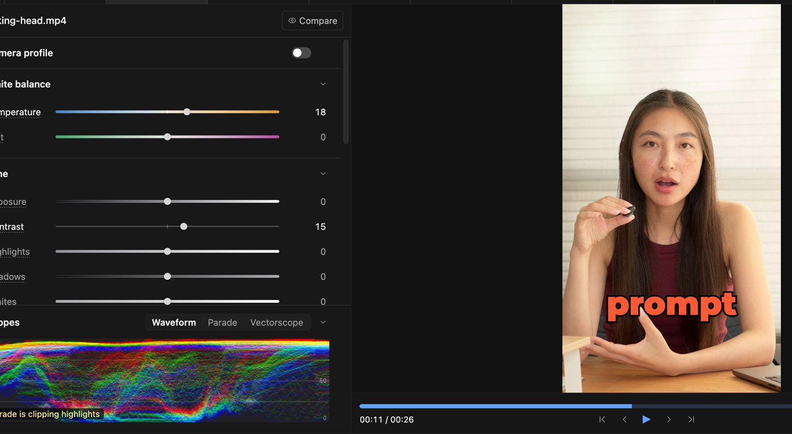

To color grade in Daydream, select your clip and describe what you want: "fix the white balance", "brighten my face", or "give it a warm, filmic look". The AI adjusts the same controls you see in the **Color** panel, then measures the result with video scopes to check its work.

## Correct first, then grade

Color correction fixes problems from the shoot, like exposure or white balance, so the footage looks natural and consistent. Color grading comes after and gives it a look or a mood. Ask for them in that order.

<Prompt description={"Fix the white balance."} actions={["copy"]}>
Fix the white balance.
</Prompt>

<Prompt description={"My face is underexposed. Brighten it up without blowing out the window."} actions={["copy"]}>
My face is underexposed. Brighten it up without blowing out the window.
</Prompt>

<Prompt description={"Remove the green cast."} actions={["copy"]}>
Remove the green cast.
</Prompt>

Then:

<Columns cols={2}>
<Prompt description={"Give it a warm, filmic look."} actions={["copy"]}>
Give it a warm, filmic look.
</Prompt>

<Prompt description={"Teal shadows and orange highlights, but keep my skin natural."} actions={["copy"]}>
Teal shadows and orange highlights, but keep my skin natural.
</Prompt>

<Prompt description={"Make the greens greener."} actions={["copy"]}>
Make the greens greener.
</Prompt>

<Prompt description={"Desaturate the yellows in this clip."} actions={["copy"]}>
Desaturate the yellows in this clip.
</Prompt>
</Columns>

<Frame caption="Before and after asking for a warm, filmic look.">
  
</Frame>

<Frame caption="Before and after asking for teal shadows and orange highlights.">
  
</Frame>

## Log footage

Log footage (S-Log3, C-Log3, V-Log, Apple Log and others) looks flat and washed out until it's converted for normal screens. In Daydream, that conversion is the clip's **Camera profile**.

For most cameras, Daydream reads the file's metadata, sets the camera profile when you first add the clip to the timeline, and shows a notice that log footage was detected. If it isn't detected, tell the AI what you shot in ("this is S-Log3") or set **Camera profile** yourself in the **Color** panel. If the AI thinks a clip looks like log but can't tell which camera shot it, it asks you instead of guessing.

| Camera | Profiles |
|---|---|
| Sony | S-Log3, S-Log2 |
| Canon | C-Log3, C-Log2 |
| Panasonic | V-Log |
| iPhone | Apple Log |

You can mix log and normal footage in one timeline. Each clip keeps its own camera profile.

## LUTs

To use a LUT, tell the AI where the `.cube` file is ("apply ~/LUTs/Kodak.cube at 60% strength"), or add it in the **Look** section of the **Color** panel. A strength of 40 to 70% is a good place to start for creative LUTs that look too heavy.

If you have a conversion LUT made for log footage, like "S-Log3 to Rec.709", say so. The AI applies it to the raw log image so it isn't converted twice.

<Frame caption="No LUT, the LUT at 50% strength, and at 100%.">
  
</Frame>

## Match clips and grade a whole video

<Prompt description={"Match the color of this clip to the one before it."} actions={["copy"]}>
Match the color of this clip to the one before it.
</Prompt>

<Prompt description={"Apply this look to every clip."} actions={["copy"]}>
Apply this look to every clip.
</Prompt>

Grades belong to each clip, so when you apply one look across a video, every clip keeps its own camera profile and only the look is shared. To match two clips, the AI compares their scopes and moves one toward the other.

## How the AI checks its work

A screen can be misleading, so colorists read scopes, and the AI does the same. After every change, it measures where the subject sits in the exposure range, whether highlights are clipping or shadows are crushed, and whether things that should be neutral, like a white wall or a grey shirt, actually are.

## Grade by hand in the Color panel

Select one video clip and open the **Color** panel:

- **Camera profile**: the conversion for log footage
- **White balance**: temperature and tint
- **Tone**: exposure, contrast, highlights, shadows, whites and blacks
- **Color**: saturation and vibrance
- **Color wheels**: lift, gamma and gain
- **Curves**: tone curves, plus hue curves to change one color at a time
- **Look**: split toning and LUTs

<Frame caption="The Color panel, with the AI's grade on the sliders and the waveform below.">
  
</Frame>

Waveform, parade and vectorscope scopes sit in the same panel. Hold the compare button to see the clip without your grade. The preview shows the change, and your export is identical.

## Limits

- Grades apply to the whole frame. To grade only the background or only the person, ask for a custom effect. See [custom effects and transitions](/style/custom-effects-and-transitions).
- Grades can't be keyframed to change over time.
- Daydream has no built-in looks or LUT pack. Use your own LUTs or describe the look.

## Grades in exports

MP4 exports include your grade. When you send your edit to another editor, you choose whether to keep the grade. See [send to Premiere, Resolve, Final Cut or CapCut](/finish/export-xml).

## Related pages

- [Add effects](/style/effects)
- [Make your own effects and transitions](/style/custom-effects-and-transitions)
- [Export to another editor](/finish/export-xml)
