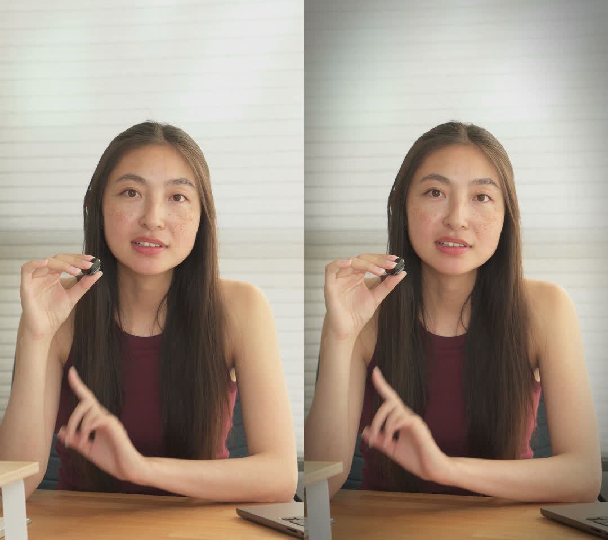

To add an effect in Daydream, ask for it by name: "add film grain", "make this clip look like a VHS tape", or "blur the license plate". The AI applies it to the clips you mean, and you can ask for it stronger, weaker or gone at any time.

Effects are added through the AI. There's no effects panel yet, so to change one, ask ("less grain", "turn off the vignette").

<Columns cols={3}>
<Frame caption="Film grain">
  <video autoPlay muted loop playsInline className="w-full rounded-xl" src="/images/guide/fx-film-grain.mp4" aria-label="Film grain"></video>
</Frame>
<Frame caption="Blur">
  <video autoPlay muted loop playsInline className="w-full rounded-xl" src="/images/guide/fx-clip-blur.mp4" aria-label="Blur"></video>
</Frame>
<Frame caption="Privacy blur on a face">
  <video autoPlay muted loop playsInline className="w-full rounded-xl" src="/images/guide/fx-privacy-blur.mp4" aria-label="Privacy blur on a face"></video>
</Frame>
<Frame caption="Window frame">
  <video autoPlay muted loop playsInline className="w-full rounded-xl" src="/images/guide/fx-window-frame.mp4" aria-label="Window frame"></video>
</Frame>
<Frame caption="VHS">
  <video autoPlay muted loop playsInline className="w-full rounded-xl" src="/images/guide/fx-vhs.mp4" aria-label="VHS"></video>
</Frame>
<Frame caption="Glitch Cut">
  <video autoPlay muted loop playsInline className="w-full rounded-xl" src="/images/guide/fx-glitch-cut.mp4" aria-label="Glitch Cut"></video>
</Frame>
<Frame caption="Dither">
  <video autoPlay muted loop playsInline className="w-full rounded-xl" src="/images/guide/fx-dither.mp4" aria-label="Dither"></video>
</Frame>
<Frame caption="Fish Eye">
  <video autoPlay muted loop playsInline className="w-full rounded-xl" src="/images/guide/fx-fish-eye.mp4" aria-label="Fish Eye"></video>
</Frame>
<Frame caption="Water">
  <video autoPlay muted loop playsInline className="w-full rounded-xl" src="/images/guide/fx-water.mp4" aria-label="Water"></video>
</Frame>
<Frame caption="Fluted Glass">
  <video autoPlay muted loop playsInline className="w-full rounded-xl" src="/images/guide/fx-fluted-glass.mp4" aria-label="Fluted Glass"></video>
</Frame>
</Columns>

<Frame caption="Without and with a vignette.">
  
</Frame>

## Effects you can ask for

| Effect | What it does | Try asking |
|---|---|---|
| Film grain | Moving film grain, strongest in the midtones like real film | "Add subtle film grain to every clip" |
| Vignette | Darkens the edges to pull the eye to the center | "Add a light vignette" |
| Motion blur | Smears fast zooms and moves like a camera shutter | "Add motion blur to the zooms" |
| Blur | Blurs a whole clip, useful behind text | "Blur the B-roll under the title" |
| Privacy blur | Blurs or pixelates a face, license plate or logo, and follows it as it moves | "Pixelate the license plate" |
| Window frame | Puts the picture in a rounded, padded window with a shadow, which moves with your zooms | "Frame the screen recording like a Mac window" |

## Built-in looks

| Look | What it does |
|---|---|
| VHS | A worn tape: tracking wobble, colors bleeding sideways, tape noise and scanlines |
| Glitch Cut | Row tearing, RGB split and noise as a clip starts and ends. Works as a transition into the next clip |
| Dither | Reduces the picture to two or three colors in a pattern, like an old screen or print. You choose the colors or keep the originals |
| Fish Eye | A barrel lens that bulges the middle and bends straight lines toward the edges |
| Water | Rippling light across the picture, as if seen through moving water |
| Fluted Glass | The picture seen through ribbed glass, each rib bending its strip |

Ask for a look by name ("add the VHS look to the intro") and adjust it the same way ("more wobble", "less noise").

## Blur a face or license plate

<Prompt description={"Blur the face of the person on the right."} actions={["copy"]}>
Blur the face of the person on the right.
</Prompt>

<Prompt description={"Pixelate the logo on the laptop."} actions={["copy"]}>
Pixelate the logo on the laptop.
</Prompt>

The AI selects the thing you mean on the first frame and follows it through the clip. Selecting by pointing sometimes grabs more than you meant, like the whole laptop instead of the logo, so the AI checks a frame and narrows it down. Following an object takes a few minutes per minute of footage, analyzed on your computer.

## On clips or on the whole video

Effects go on the clips you ask about, so captions and titles stay clean. Grain and vignette can also go over the whole frame, text included, if you ask for "film grain over everything".

You can stack different effects on one clip, like grain plus a vignette.

## In exports

MP4 exports include every effect. When you send your edit to Premiere Pro, DaVinci Resolve, Final Cut Pro or CapCut, effects on clips are rendered into new video files while **Keep color grade & effects** is on (the default). Motion blur, window frames and effects over the whole frame aren't included in those handoffs.

## Want something else?

If the look you want isn't here, like CRT scanlines, halftone or chromatic aberration, the AI can write a custom effect for it. See [make your own effects and transitions](/style/custom-effects-and-transitions). For background blur, color pop and text behind you, see [blur your background and put text behind you](/style/background-and-text-behind).

## Related pages

- [Make your own effects and transitions](/style/custom-effects-and-transitions)
- [Color grade your footage](/style/color-grading)
- [Add zooms and camera moves](/style/zoom-effects)
