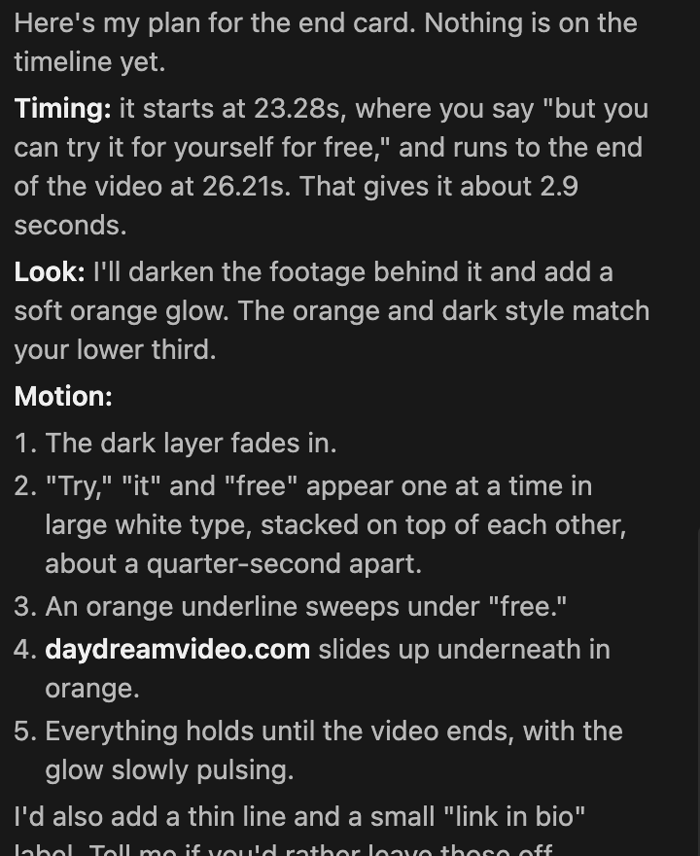

To make motion graphics in Daydream, describe what you want in chat, like "a lower third with my name and title" or "an animated chart of our growth". The AI plans it, builds it as a clip on your timeline over your footage, and checks how it looks before handing it back to you.

## Ask for a graphic

<Columns cols={2}>
<Prompt description={"Add a title card at the start that says \"5 Tips for Better Sleep\"."} actions={["copy"]}>
Add a title card at the start that says "5 Tips for Better Sleep".
</Prompt>

<Prompt description={"Add a lower third with my name, Maya Chen, and \"Founder, Lumen\" when I first appear."} actions={["copy"]}>
Add a lower third with my name, Maya Chen, and "Founder, Lumen" when I first appear.
</Prompt>

<Prompt description={"Animate a bar chart showing revenue going from $10k to $80k over four quarters."} actions={["copy"]}>
Animate a bar chart showing revenue going from $10k to $80k over four quarters.
</Prompt>

<Prompt description={"Highlight the words \"save 2 hours a day\" as I say them, like a marker swipe."} actions={["copy"]}>
Highlight the words "save 2 hours a day" as I say them, like a marker swipe.
</Prompt>

<Prompt description={"End the video with our logo animating in. Use logo.png from my assets."} actions={["copy"]}>
End the video with our logo animating in. Use logo.png from my assets.
</Prompt>
</Columns>

<Columns cols={2}>
<Frame caption="A lower third the AI built from one sentence.">
  <video autoPlay muted loop playsInline className="w-full rounded-xl" src="/images/guide/graphics-lower-third.mp4" aria-label="A lower third the AI built from one sentence."></video>
</Frame>
<Frame caption="An end card with the words building in one by one.">
  <video autoPlay muted loop playsInline className="w-full rounded-xl" src="/images/guide/graphics-end-card.mp4" aria-label="An end card with the words building in one by one."></video>
</Frame>
</Columns>

## The AI plans first, then builds

For anything more than a simple title, the AI first describes what it's going to make: what's on screen, how it moves, and how long it lasts. It waits for you to approve or change the plan before building. That way you're not waiting on a graphic you didn't want.

<Frame caption="The plan the AI shows before building a graphic.">
  
</Frame>

It builds one graphic at a time. For a sequence, like a title, then three tip cards, then an end card, it plans and builds the first, lets you see it, then moves to the next.

When it's done, it checks the graphic over your actual footage: whether text is readable against the background, whether anything runs off screen, and whether the animation has dead spots.

## Change a graphic

Ask for what you'd change:

<Prompt description={"Make the title bigger and slow down the entrance."} actions={["copy"]}>
Make the title bigger and slow down the entrance.
</Prompt>

<Prompt description={"Change the colors to match our brand: navy and orange."} actions={["copy"]}>
Change the colors to match our brand: navy and orange.
</Prompt>

<Prompt description={"The lower third covers my face. Move it to the left."} actions={["copy"]}>
The lower third covers my face. Move it to the left.
</Prompt>

Or select the graphic on the timeline to move, trim and resize it like any other clip. To change its text or colors, ask the AI.

## Use your own images and footage

Graphics can use images from your library, like logos, screenshots and photos. Mention the file by name or with **@**. Images stay linked to their file on your computer, so don't move or delete them while you're still using the graphic.

<Warning>
Graphics can also include video, like a picture-in-picture card or a side-by-side comparison. Use this sparingly: every video inside a graphic slows down playback and export, a lot on Windows. For effects on your own footage, like blurring the background or putting text behind you, use [effects](/style/background-and-text-behind) instead.
</Warning>

## Put graphics behind you or on the beat

- Text can sit behind the person in the shot. Ask for "the title behind me". See [blur your background and put text behind you](/style/background-and-text-behind).
- Graphics can animate in time with your music. See [edit to the beat](/edit/edit-to-the-beat).

## Tips

- The most capable models, Fable 5.2 and GPT-6 Astra, tend to make the best graphics. See [choose a model](/ai/work-with-the-ai#choose-a-model).
- Give brand details up front: colors, fonts and your logo. That's the biggest difference between a generic result and one that looks like yours.
- If you switch the project between horizontal and vertical, graphics are reframed automatically. If one looks cramped, ask the AI to rebuild it.

## Reuse a graphic

Save a graphic you like, such as an intro or a lower third, and drop it into future videos. See [save caption styles and graphics](/automate/saved-styles).

## Graphics in exports

MP4 exports include graphics as they look in the preview. When you send your edit to Premiere Pro, DaVinci Resolve, Final Cut Pro or CapCut, each graphic becomes a video clip with a transparent background, at 1080p or 4K.

## Related pages

- [Add captions](/style/captions)
- [Add zooms and camera moves](/style/zoom-effects)
- [Save caption styles and graphics](/automate/saved-styles)
