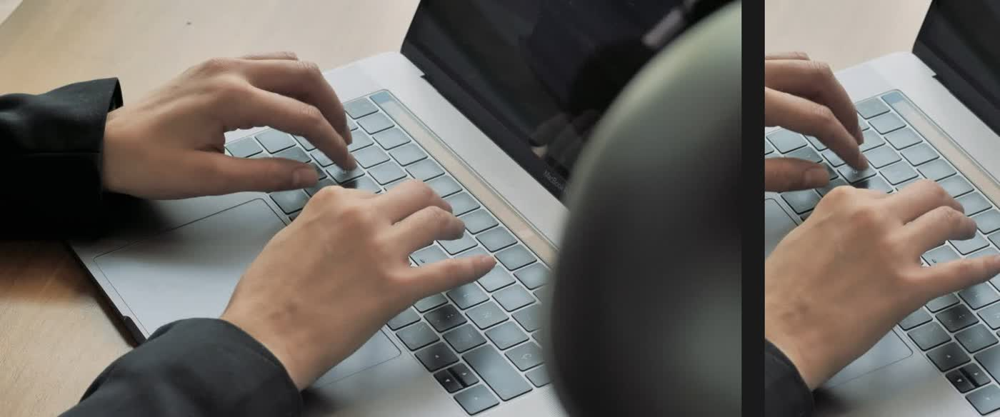

To make a vertical video in Daydream, choose **File > Switch to Vertical Video (9:16)**, or ask the AI to "make this vertical". Every new project starts horizontal (16:9), so if you're making Shorts, Reels or TikToks, switch before you start editing.

Daydream supports two shapes: horizontal 16:9 and vertical 9:16. Square and 4:5 aren't available yet.

<Frame caption="The same shot in a horizontal project and in a vertical one, where the sides are cropped.">
  
</Frame>

## Start a vertical project

<Steps>
  <Step title="Create a new project" />
  <Step title="Switch to vertical">
    Choose **File > Switch to Vertical Video (9:16)** and confirm.
  </Step>
  <Step title="Edit as usual" />
</Steps>

Switching first matters because captions and graphics are designed for the frame they're made in. If you build a title in a horizontal project and switch afterwards, Daydream reframes it, but a graphic designed for a wide frame rarely looks as good squeezed into a tall one.

## Turn a horizontal video into a vertical one

<Warning>
Switching changes the project itself. Duplicate it first if you want to keep the horizontal version.
</Warning>

<Steps>
  <Step title="Duplicate the project">
    Right-click the project's tab at the top of the window and choose **Duplicate**.
  </Step>
  <Step title="Switch the copy to vertical">
    In the copy, choose **File > Switch to Vertical Video (9:16)**.
  </Step>
  <Step title="Check each shot">
    In a vertical frame, horizontal footage fills the height and the sides are cropped, centered by default. If someone ends up half out of frame, ask the AI to fix it:

    <Prompt description={"Keep me centered in every shot."} actions={["copy"]}>
    Keep me centered in every shot.
    </Prompt>

    <Prompt description={"Move the B-roll at 0:42 so the product is in frame."} actions={["copy"]}>
    Move the B-roll at 0:42 so the product is in frame.
    </Prompt>
  </Step>
</Steps>

You can also select a clip and change its **Position** in **Properties**.

Graphics the AI made for the horizontal version are reframed automatically. If one looks cramped, ask the AI to rebuild it for vertical.

## How does footage fit each shape?

| Project | Horizontal footage | Vertical footage |
|---|---|---|
| Vertical (9:16) | Fills the frame, sides cropped | Fills the frame |
| Horizontal (16:9) | Fills the frame | Fits inside with bars on the sides |

## Switching back

Choose **File > Switch to Horizontal Video (16:9)**. You can switch as often as you like. Clip positions, captions and graphics move with each switch.

## Related pages

- [Make your first video](/first-video)
- [Add captions](/style/captions)
- [Export a video](/finish/export)
